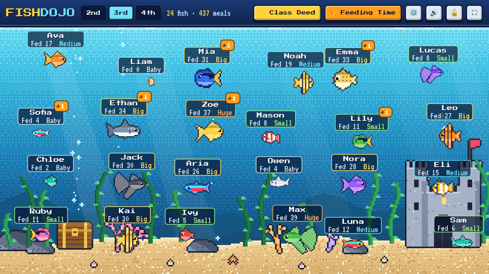

# 🐠 FishDojo



A ClassDojo-style classroom tracker built as a pixel-art aquarium. Every student has a fish. Good deeds earn food, and each feeding makes the fish grow.

Built for a classroom smartboard: one full-screen 1920×1080 layout that scales to any screen, with big touch targets and text you can read from the back of the room.

## How it works

1. **Pick a grade**: 2nd, 3rd or 4th. Each grade is its own class of up to **24 students**.
2. **Tap a fish** to open that student's card, then tap a **good deed** (Helping Others, Kindness, Hard Work…). Each deed gives **+1 food**, and an orange badge on the fish shows the food waiting.
3. The student taps **FEED MY FISH!** Food pellets drop into the tank, the fish swims up and eats them, and it grows.
4. Each fish shows the **student's name**, **how many times it has been fed** and **how big it is**:

   | Meals | Size |
   |---|---|
   | 0 | Baby |
   | 5 | Small |
   | 12 | Medium |
   | 22 | Big |
   | 35 | Huge |
   | 50 | Giant ✨ |
   | 75 | Legend 👑 |

Top-bar buttons:

- **⭐ Class Deed**: the whole class gets +1 food.
- **🍤 Feeding Time**: every fish eats all of its waiting food at once.
- **⚙️ Setup**: add or rename students (you can paste a list of names), pick each student's fish (Goldfish, Clownfish, Blue Tang, Angelfish, Pufferfish, Betta, Neon Tetra, Shark) and color, edit the good-deed list, back up or restore data, and reset.
- **🔓 Student Mode**: hides the deed buttons and settings so students can only feed their own fish. You can set an optional teacher PIN to unlock it.
- **⛶ Full screen** (or press `F`).
- **↶ Undo** on a student card reverses that student's last deed or feeding.

## Where is the data stored?

Everything is saved in the browser on the computer running it (`localStorage`). No accounts, no server, and no student data leaves the classroom.
Use **Setup → Backup & Reset → Download Backup** now and then, and use the same file to move your classes to another computer.

## Putting it on a web address (free)

The app is plain HTML/CSS/JS with no build step, so GitHub Pages can host it:

1. Merge this code into the `main` branch.
2. In the GitHub repo, open **Settings → Pages**. Under **Build and deployment → Source**, choose **GitHub Actions**.
3. The included workflow (`.github/workflows/pages.yml`) publishes the site on every push to `main`. It will be at:

   **https://alpkabac.github.io/FishDojo/**

4. *(Optional)* For a shorter address such as `fishdojo.com`, buy the domain from any registrar. Then enter it under **Settings → Pages → Custom domain** and follow GitHub's DNS instructions.

On the smartboard, open the address in Chrome or Edge, press ⛶, and you're ready to go.

## Running locally

Open `index.html` directly in a browser, or serve the folder:

```sh
python3 -m http.server 8000   # then open http://localhost:8000
```

## Credits

Fonts: [Press Start 2P](https://fonts.google.com/specimen/Press+Start+2P) and [VT323](https://fonts.google.com/specimen/VT323), both under the SIL Open Font License (see `fonts/`). All fish and scenery are generated in code as pixel art.
